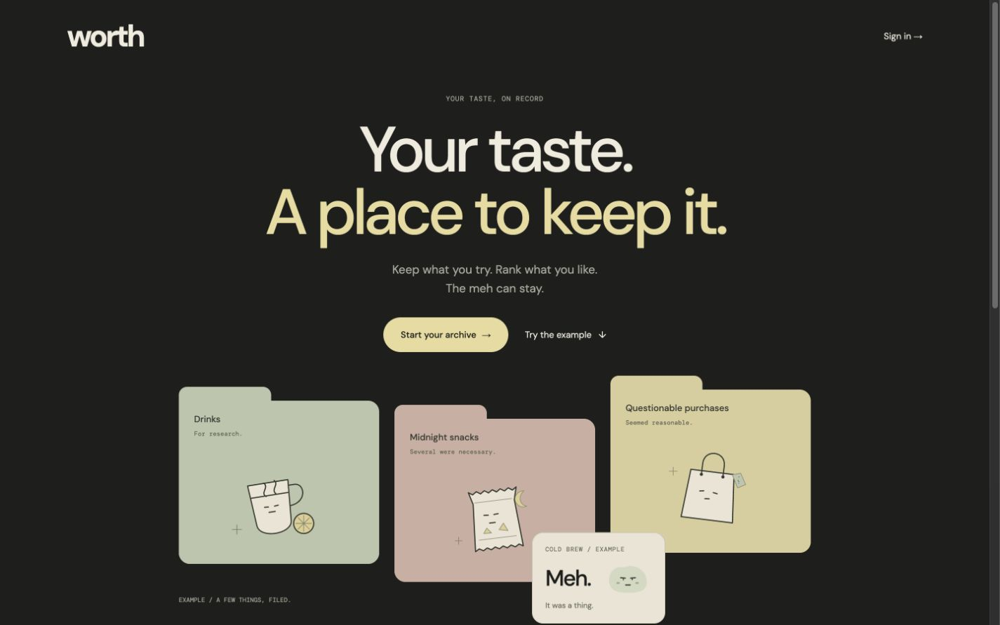

# Worth

[](https://github.com/aiden-jang/worth/actions/workflows/ci.yml)

A private archive for what you try, keep, rank and revisit.
[Open Worth](https://worth.aidenjang.com).

Collections keep names first, with optional types, calls, ranks, notes, photos and
revisit history. Activities hold dated entries, exercise sets, workouts and reusable
routines. New accounts start empty. The signed-out interactive example is explicitly
labeled and never writes to a private archive.



## Features

- Capture one name or a batch; add context later. Drafts can recover on the same device.
- Keep routine targets separate from actual results, group exercise aliases without
  renaming history, and log explicit named measurements with their original units.
- Import up to 100 records from CSV with mapped columns, exact previews and explicit
  duplicate choices. Keep a source link with an editable name suggested from its address.
- Make a reversible call: **Favorite**, **Meh**, **Not again**, or no call. Calls,
  manual rank and the revisit queue remain independent.
- Save a name to **Want to try** without changing its call, rank or revisit queue.
- Select up to 100 items to move, queue, change type, or send to Trash. Merge up to 20 while keeping original notes, photos and visits; separate them again in Details.
- Keep an optional location, edition, order/setup and reaction for each revisit, separately from the overall call.
- Archive collections from their settings and find them under Collections → Archived. Records stay editable and searchable; unarchive whenever you want.
- Undo deletions immediately, or restore lists, items and logs from Settings → Trash for 30 days.
- Open a collection’s Workbench for draft rankings, blind head-to-head comparisons,
  a private comparison table, or a draw from Want to try, the revisit queue or Favorites.
- Save filter views and named context rankings across devices. Applying a sandbox
  ranking requires a preview and checks for newer edits.
- Review matching names/types in Workbench → Comparison table. Open or revisit
  a record, or save a reversible keep-separate review without merging anything.
- Browse paper pockets or book spines in Workbench → Your shelf. Choose a private
  keepsake, dedication, record inscription and optional arch/plant bookend.
- Keep optional recommendation sources, reasons, personal labels/stamps, version/location
  details and custom fields. Track purchases and loans, and download a calendar return reminder.
- Make a booklet from up to 12 selected records, with captions and explicit rank/call/note/photo
  options. Download an offline HTML copy or print/save a PDF. Prepare an individual recommendation
  card as a PNG with your own message and a preview of exactly what leaves Worth.
- Prepare a passphrase-protected offline text copy, queue Inbox captures or note edits, and explicitly sync with account/reset/conflict checks. Bookmark the separate offline page; images and extended detail remain in connected Worth.
- Collaborate in private spaces with verified-email invitations, viewer/editor access, selected text snapshots and shared notes. Make two-person choices privately and reveal them together; preserve disconnected private copies.
- Seal private time capsules with a message, opening date/timezone and explicitly reviewed record/photo snapshots; compare them with current sources after opening. Owner backups include unopened contents.
- Assemble a personal field guide across collections, with explicit note/location/photo choices, captions, an exact preview and an offline HTML or printable copy.
- Link related finds, editions, the same thing across places and reasoned replacement chains in Patterns → Connections, with a readable constellation view.
- Review future ranking/call changes in Workbench → Taste history, keep optional reasons/linked visits, and compare older orders in the sandbox.
- Set an optional revisit date and snooze in record context. Patterns → Activity calendar separates those plans from entered visits and activity logs, with a readable daily agenda.
- Gather cross-collection records and visits into private moments, shortlists, evening and trip boards, with manual stop replay and a readable list.
- Browse collections, search private records, view Patterns, and review workout history.
- Choose a period in Patterns → Look back for a private recap of currently kept finds and dated logs.
- Keep up to 12 private photos per record, add separate captions/arrows, choose their order and cover, or compare two originals with a keyboard slider and full side-by-side view.
- Add private item/log photos and collection covers, or choose optional built-in artwork.
  Artwork includes ramen, sneaker, plant and camera objects in sage, clay and butter.
- Present a private ranking, create a seven-day revocable snapshot link, or download/share
  a ranking image. Only the collection name and ranked titles/types leave the archive.
- Keep private unfiled finds in Inbox, recover edits and filing retries, then file into a collection unranked.
- Read English printed text from a photo on-device, edit it, then review a name and optional note before saving. No photo upload or external AI processing is used for recognition.
- Review receipt text on-device, attach an exact checked image copy if you choose, and map each line to an existing record or an explicitly named new unranked record. Receipt removal leaves sources intact.
- Read product barcodes on-device, or optionally look up a checked ISBN and review a book title before capture.
- Review browser-shared text/links in web capture; bookmark private shortlist and saved-find shortcuts.
- Arrange saved photos into a private cover collage, with keyboard positioning,
  optional captions, exact preview, local download and reviewed cover replacement.
- Save reusable collection detail names and private setup templates for new, empty collections.
- Export records or a photo-inclusive backup; preview a validated restore as new lists.
  Worth-only data deletion leaves the shared account and other apps alone.

## Local development

Use Node 22 and pnpm 9.15.0, as pinned in `.nvmrc` and `package.json`.

```sh
pnpm install --frozen-lockfile
pnpm db:migrate:local
pnpm dev
```

Open `http://localhost:34300`. The local Worker expects Accounts at
`http://localhost:34100`. Run that service, or use `node tests/fake-auth.mjs` and
visit `http://localhost:34100/preview-login` for a local-only preview. Stop the stub
before testing real sign-in. Never use it in production.

```sh
pnpm exec playwright install chromium
pnpm check
```

`check` runs formatting, ESLint/hooks, unused-code detection, unit/component/API tests,
Worker/TypeScript checks, a production build, and desktop/phone browser journeys.
The D1 tests and browser preview use isolated local state. Browser API fixtures stay
in `e2e/`; they are not shipped. See [contributing](CONTRIBUTING.md) for individual checks.

See [archive tools](docs/ARCHIVE-TOOLS.md) for move, merge, recovery and export behavior.

## Repository guide

| Document                                                                                 | Purpose                                                            |
| ---------------------------------------------------------------------------------------- | ------------------------------------------------------------------ |
| [Architecture](docs/ARCHITECTURE.md)                                                     | Module ownership, data invariants, auth/sharing/storage boundaries |
| [Contributing](CONTRIBUTING.md)                                                          | Setup, tests, UI verification and commit conventions               |
| [Design](DESIGN.md), [voice](VOICE.md), [build contract](art/ui-mocks/BUILD-CONTRACT.md) | Current visual and product requirements                            |
| [Deploy](DEPLOY.md)                                                                      | Automatic deployment and operator commands                         |
| [Release and recovery](RELEASE.md)                                                       | Smoke checks, backups, incidents and external verification limits  |
| [Security](SECURITY.md)                                                                  | Private reporting and maintained branch                            |

One Cloudflare Worker serves React and `/api/*` on the same origin. D1 stores
owner-scoped records and bounded private photos; shared Accounts verifies sessions.
Public links expose a fixed snapshot, never live private notes, dates, history or photos.
Downloaded images and exported backups cannot be revoked and should be kept private.

The accepted cabinet compositions and historical QA live in `art/`; latest sections of
the build contract take precedence over earlier designs. Installed-app shortcuts open
capture or the workout chooser. Manifest previews live in `public/screenshots/`.

Merging to `main` triggers CI and the existing automatic deployment. See [DEPLOY.md](DEPLOY.md)
before using any manual release or remote database command.

Offline preparation is verified against the built local Worker (the same server
used by browser tests). The development server does not install a persistent
service-worker cache of development modules. Bookmark the prepared `/offline/`
page for disconnected reading; the connected app keeps its normal sign-in flow.
