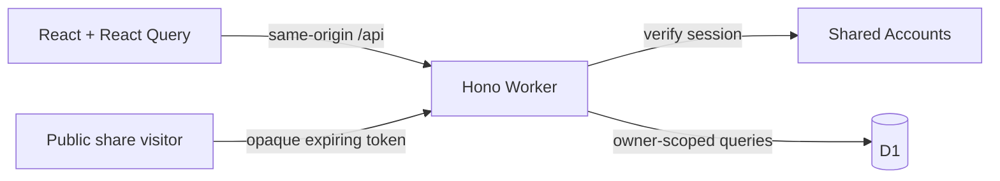

# Architecture

Worth is one same-origin React application and Cloudflare Worker. D1 holds private
records and bounded photo BLOBs. Shared Accounts owns authentication.

## Ownership

| Location               | Responsibility                                                                          |
| ---------------------- | --------------------------------------------------------------------------------------- |
| `src/App.tsx`          | Public/private routing, session recovery, lazy screens and top-level error boundary     |
| `src/pages/`           | Page orchestration and query state                                                      |
| `src/components/`      | Cabinet UI, collection index, editors, list settings, workouts and dialogs              |
| `src/api.ts`           | Same-origin transport, bounded requests, cancellation and readable failures             |
| `src/shared/`          | Shared types/validation and pure ranking, capture, exercise and portability rules       |
| `src/hooks/`           | Account-scoped device drafts, photo drafts, connectivity and tab preferences            |
| `worker/index.ts`      | Public/private middleware, auth, write limits, route registration and errors            |
| `worker/routes/`       | Lists, items, logs, overview/patterns, search, shares, photos, portability and workouts |
| `worker/data.ts`       | Owner-scoped record lookup and database-to-API mapping                                  |
| `worker/http.ts`       | Request limits, validation, origin enforcement and response security headers            |
| `worker/operations.ts` | Retry identities, payload fingerprints and prior-operation lookup                       |
| `migrations/`          | Ordered additive D1 schema history                                                      |
| `tests/`, `e2e/`       | Pure/component/API regressions and production-build browser journeys                    |

Keep orchestration in the page/view, persistence in the API/Worker, and independent
editors in their own components. Do not introduce a repository layer that simply
forwards every query. Parameterized SQL and owner checks belong together. The
activity editor remains cohesive because its measurements, draft, photos and workout
selection form one save operation; split further when a section gains independent behavior.

## Data invariants

- A collection contains items and dated revisits. An activity contains dated logs,
  optional exercise sets, workout visits and reusable routines.
- Calls are `favorite`, `meh`, `would_not_again` or `null`. Rank and revisit queue are
  separate; sorting a screen never changes saved rank. Conflicting rank revisions
  return 409 and require refreshed data rather than silently overwriting another edit.
- Drafts expire after seven days and use the account and record/list identity. Collection browsing
  context stays in tab memory; global Search uses `q` and `scope` URL parameters. Blocked device
  storage must not stop browsing. Draft persistence is best effort, not a backup.
- Capture and restore retries preserve operation identities. Payload fingerprints keep
  a changed batch/import from being replayed under an old key. UI timeouts do not prove
  that a server mutation failed; verify saved state before retrying an ambiguous operation.
- Every private lookup/mutation verifies the owner. IDs alone do not grant access.
  Cross-origin writes are rejected. The browser never receives Accounts credentials
  beyond the existing shared session cookie.

## Sharing, files and caching

Public tokens are hashed in storage and expire after seven days. Snapshots contain
only ranked titles/types and a collection name; subsequent private edits do not update
an existing snapshot. Revocation removes access to the link. Images handed to a share
sheet or downloaded cannot be revoked. Keep preview options fixed during link creation.

Photos/covers are owner-checked, no-store and limited to 900 KB after client compression.
Records-only export excludes them; photo-inclusive backup includes them. Restore validates
and atomically creates fresh private records, preserves relationships and never restores
public shares. See [release/recovery](../RELEASE.md) for import limits and deletion scope.

The service worker handles the app shell/static assets; it must not cache private API
responses or invent offline write success. Private and shared routes have no-index headers.
Fonts are bundled locally. Static CSP/security headers live in `public/_headers`; API
headers are applied by the Worker. No mock archive is bundled into production.

## Build and release

Vite emits `dist/client` and `dist/worth`, including a generated Wrangler configuration.
CI builds once, uploads that complete output, then browser-tests and deploys the same
artifact. Deployment runs only for `main`, after core and browser checks, and applies
migrations before deploying with the generated config. PRs have no deployment step.
The deploy job is serialized and ends with the read-only live smoke check.

Unit/component tests use Vitest. API tests run against a temporary real D1 runtime;
auth is mocked at the Accounts-client boundary. Browser tests use Chromium with
synthetic intercepted API responses and test both 1440×900 and 390×780. These tests
cover UI contracts, not the production Accounts service or a real phone's native share sheet.
