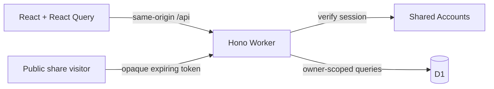

# Architecture

Current analytics: `analytics/` holds the fixed browser/Worker event contract, bounded
anonymous ingestion and credential-free transport. See [Analytics](ANALYTICS.md) for
coverage, privacy and dashboard queries. Private app paths are not traffic dimensions.

Worth is one same-origin React application and Cloudflare Worker. D1 holds private
records and bounded photo BLOBs. Shared Accounts owns authentication.

## Ownership

| Location               | Responsibility                                                                          |
| ---------------------- | --------------------------------------------------------------------------------------- |
| `src/App.tsx`          | Public/private routing, session recovery, lazy screens and top-level error boundary     |
| `src/pages/`           | Page orchestration and query state                                                      |
| `src/components/`      | Cabinet UI, collection index, editors, list settings, workouts and dialogs              |
| `src/api.ts`           | Same-origin transport, bounded requests, cancellation and readable failures             |
| `src/shared/`          | Shared types/validation and pure ranking, capture, exercise and portability rules       |
| `src/hooks/`           | Account-scoped device drafts, photo drafts, connectivity and tab preferences            |
| `worker/index.ts`      | Public/private middleware, auth, write limits, route registration and errors            |
| `worker/routes/`       | Lists, items, logs, overview/patterns, search, shares, photos, portability and workouts |
| `worker/data.ts`       | Owner-scoped record lookup and database-to-API mapping                                  |
| `worker/http.ts`       | Request limits, validation, origin enforcement and response security headers            |
| `worker/operations.ts` | Retry identities, payload fingerprints and prior-operation lookup                       |
| `migrations/`          | Ordered additive D1 schema history                                                      |
| `tests/`, `e2e/`       | Pure/component/API regressions and production-build browser journeys                    |

`src/styles.css` owns the shared palette and base controls used by both connected
and offline entries. Cabinet styles supply opinion slips, artwork and presentation;
feature styles own their content. `src/workspace.css` owns connected page framing,
titles and spacing. Keep each declaration with its owner instead of adding another
theme or override layer. Shelf colors/styles and list-kind classes are generated
from saved choices; literal-only class searches cannot establish that they are unused.

Keep orchestration in the page/view, persistence in the API/Worker, and independent
editors in their own components. Do not introduce a repository layer that simply
forwards every query. Parameterized SQL and owner checks belong together. The
activity editor owns drafts, photos, workout selection and one save operation.
`ExerciseSetFields`, `LegacyActivityMeasurements` and `ActivityMeasurements` are controlled
field components; they receive only their section of the draft and do not persist it.

`AppShell` owns Home / Collections / Look back navigation, the consistently named
Add action, keyboard shortcuts, save/Undo feedback and a skip link. Phones use a
persistent safe-area primary bar; the header disclosure holds utility/account links
and is not a modal focus trap. Escape restores its toggle and a desktop resize
clears it. Context menus close on outside focus/pointer or Escape; native dialogs
retain their own focus handling.

`QuickEntry` is lazy and delegates to existing Inbox, item, experience and activity
endpoints. `shared/quick-entry` validates account-scoped device drafts and their
frozen discriminated retry payloads. Each save freezes its destination, operation
identity and body before the request. Optional photos use a deliberate two-stage
save: create/update the record, then upload the prepared image with its own stable
operation identity. Drafts retain both identities and the frozen image; exact
retries confirm the saved record and photo without duplicating either. Text and
photo writes are not presented as one database transaction.
A new collection experience still uses the existing transactional endpoint; activity
capture creates one plain dated entry. Names without a collection use the existing
Inbox store. The UI calls that store Unfiled; JSON/API names remain compatible.

`ArchivePage` merges the owner's real overview records and Unfiled finds for recent
browsing, retaining whether a date is an experience date or a saved/updated timestamp.
`CollectionView` preserves capture/filter/rank orchestration, with a single selected
slip on desktop and `ItemSheet` in a body-level native phone dialog. Selection starts
closed on each new list view. Successful inline capture restores input focus without
opening the slip. `OpinionSlip` accepts the appropriate heading level for its context.

`PatternsPage` is the Look back entry point, with Memories and Insights views.
`MemoryPage` can render inside that landmark or directly at its legacy route.
URL filters and query cancellation remain intact. Specialized recall tools retain
their original routes. `WorkoutSessions` renders active visits before the optional
tools supplied by `ActivityView`, followed by a collapsed past directory. Past
query/date filters do not filter active visits or their entries. Page-owned titles
identify the core directories as well as individual records.

Validation uses Zod 4. Creation defaults and patch semantics are separate:
omitted patch properties must stay absent, never reset stored values. Nested
creation context uses pre-parse defaults; unfinished local drafts deliberately
omit cross-field save requirements. Saved galleries and capsules inherit their
refinements through `safeExtend`; backup schemas retain literal text and perform
their relationship checks at the archive boundary. Compatibility tests cover
sparse patches, no-call defaults and incomplete drafts alongside API round trips.

## Data invariants

- A collection contains items and dated revisits. An activity contains dated logs,
  optional exercise sets, workout visits and reusable routines.
- Calls are `favorite`, `meh`, `would_not_again` or `null`. Rank and revisit queue are
  separate, as is Want to try; sorting a screen never changes saved rank. Conflicting rank revisions
  return 409 and require refreshed data rather than silently overwriting another edit.
- Drafts expire after seven days and use the account and record/list identity. Collection browsing
  context stays in tab memory; global Search uses `q` and `scope` URL parameters. Blocked device
  storage must not stop browsing. Draft persistence is best effort, not a backup.
- Capture and restore retries preserve operation identities. Payload fingerprints keep
  a changed batch/import from being replayed under an old key. UI timeouts do not prove
  that a server mutation failed; verify saved state before retrying an ambiguous operation.
- Every private lookup/mutation verifies the owner. IDs alone do not grant access.
  Cross-origin writes are rejected. The browser never receives Accounts credentials
  beyond the existing shared session cookie.

The document's API transport binds once to its first signed-in account. Private
requests carry `X-Worth-Account`, checked against the resolved session before
reads or writes. This is a consistency precondition, never authentication. Focus
and account-mismatch responses revalidate `/me`; a changed account removes the
old app shell and requires a document reload, clearing its query cache. Delayed
old operations keep their original binding and cannot run under the new session.
Drafts remain keyed to the original account. Public snapshots and `/me` do not
use this precondition.

## Sharing, files and caching

Public tokens are hashed in storage and expire after seven days. Snapshots contain
only ranked titles/types and a collection name; subsequent private edits do not update
an existing snapshot. Revocation removes access to the link. Images handed to a share
sheet or downloaded cannot be revoked. Keep preview options fixed during link creation.

Photos/covers are owner-checked, no-store and limited to 900 KB after client compression.
Records-only export excludes them; photo-inclusive backup includes them. Restore validates
and atomically creates fresh private records, preserves relationships and never restores
public shares. See [release/recovery](../RELEASE.md) for import limits and deletion scope.

The separate `/offline/` browser page has an explicitly prepared service worker
scoped to that page. It caches only its public HTML and hashed scripts/styles/fonts.
Private API/media responses never enter CacheStorage. Private and shared routes
have no-index headers. Account text and pending requests are encrypted in IndexedDB;
they are never presented as server saves before explicit sync confirmation.
Fonts are bundled locally. Static CSP/security headers live in `public/_headers`; API
headers are applied by the Worker. No mock archive is bundled into production.

## Build and release

Vite emits `dist/client` and `dist/worth`, including a generated Wrangler configuration.
CI builds once, uploads that complete output, then browser-tests and deploys the same
artifact. Deployment runs only for `main`, after core and browser checks, and applies
migrations before deploying with the generated config. PRs have no deployment step.
The deploy job is serialized and ends with the read-only live smoke check.

Unit/component tests use Vitest. API tests run against a temporary real D1 runtime;
auth is mocked at the Accounts-client boundary. Browser tests use Chromium with
synthetic intercepted API responses and test both 1440×900 and 390×780. These tests
cover UI contracts, not the production Accounts service or a real phone's native share sheet.

## Recoverable archive operations

Migration 0011 adds `trashed_at`, `want_to_try`, `merged_into_id` and active read views.
Ordinary reads use `active_lists`, `active_items` and `active_logs`; `record_items`
also includes preserved merged originals for history, photos and export. Writes
still target the original tables. Lookups cannot access records underneath a trashed
parent. New queries must preserve these boundaries.

Bulk operations use one guarded D1 transaction and an owner-bound, fingerprinted
retry receipt. JSON selections bound query/parameter counts even for 100-item Undo.
Rank removal edits the current database order and increments its revision. Moving a
main item carries its merged originals and all attached logs, including trashed logs.
Merges preserve original rows and photo/log ownership; separating changes membership,
without overwriting either record. Export/import preserves the merge relationship.

See [archive tools](ARCHIVE-TOOLS.md) for retention, privacy and UI contracts.

## Collection workbench

`CollectionWorkbench` owns a local ranking sandbox, binary-insertion head-to-head
comparisons, a private comparison table and filtered shuffled draws. Pure ordering
rules live in `src/shared/workbench.ts`. Drafts use the existing account/list-scoped
seven-day draft storage; comparisons are intentionally in memory. Applying an order
uses the existing rank revision boundary and an explicit old/new confirmation.

Migration 0012 adds `lists.workspace_json` and an independent workspace revision.
`worker/routes/workspace.ts` validates and persists bounded named views and context
rankings. A single conditional update checks the owner, active parent, revision and
all selected active item relationships. Requests are limited to 512 KiB, with at most
20 rankings of 500 unique items and 30 filter views. Other JSON routes keep 16 KiB.
Concurrent tabs receive 409 instead of overwriting newer tools. These changes do
not touch the main ranking, calls or list recency.

Reads omit absent/trashed/merged/moved items from context orders. Export includes
workspace state only for active lists and remaps context item IDs on restore; old
backups default to empty tools. Deleting all data cascades through the containing
lists. Public snapshots retain their fixed title/type-only payload. See
[capabilities](FEATURES.md) for the maintained feature overview.

## Private item context

Migration 0013 adds `items.context_json` and `context_revision`. Shared validation
and calendar serialization live in `src/shared/item-context.ts`; the editor and
read-only presentation are separate components. Context is optional and does not
change calls, rankings, revisit status or the name-only capture path.

Item create/patch requests allow 32 KiB; context arrays/text have explicit bounds.
An actual context change requires its expected revision, checked in the same SQL
update as the record fields. Identical retries preserve the revision. Patches that
do not change context leave its JSON untouched. The editor persists the expected
revision with its draft; newer server context cannot silently replace local edits.
Reloading context requires confirmation and preserves unrelated form edits.

Exports/imports include context and older files default to empty context. Merge,
move and Trash retain the original item row. Read-only context remains accessible
on merged originals and the comparison table. Collection search includes context;
global search matches meaningful JSON scalar values rather than field names or
default state markers. Saved filter views include optional label/stamp filters.

Calendar reminders are local `.ics` downloads with an explicit title/date preview,
an all-day event and a one-day-before display alarm. Serialization escapes text
and folds by UTF-8 octets. Person/private-note fields are not put in these files.
Worth does not request notification permission, schedule a server job or send a
message. Importing the file into a calendar is a separate user action.

## Booklets and recommendation cards

`CollectionPublishing` is a fourth workbench tool. It explicitly projects selected
records into bounded export models in `src/shared/booklet.ts`; context, history,
source links, internal IDs and account details are excluded. Booklets include up
to 12 names/types, a cover title, dedication and captions. Ranks, calls, private
notes and photos require opt-in. Cards include one name/type and a user-written
message/recipient; collection name and photo are optional. Existing public snapshot
payloads are unchanged.

`booklet-export.ts` embeds local WOFF2 fonts and selected owner-checked raster
photos into self-contained HTML, or renders a 1080-pixel-wide PNG. Photo headers
are bounded before decode, then displayed pixels are reencoded to discard original
EXIF/XMP metadata without changing the stored photo. Asset failures
stop preparation and retain settings for retry. Unmount aborts preparation.
HTML escapes all text, validates data URLs and contains a restrictive CSP with no
scripts or network access. It opens offline and prints on A5 pages. In-app print
uses a portal with only the selected prepared data; print CSS hides the rest of
the app. Its page rule exists only while that prepared booklet is mounted.

The current projection fingerprints the prepared file; edits disable download,
print and sharing until a new file is prepared. Card previews show the actual PNG
and provide its full text to assistive technology. Native sharing is offered only
when the browser supports that file; cancelling never initiates a download.
Export settings use account/list-scoped seven-day device drafts, not server
persistence. No API writes or third-party processing occur during preparation.
Downloaded/shared files cannot be revoked.

## Private collection shelves

`CollectionShelf` adds a secondary workbench view with paper pockets/book spines,
optional authored bookends, a private dedication, a keepsake and a record-bound
inscription. It reuses the workspace JSON/revision added in migration 0012, with
an optional bounded `shelf` property; no new migration is needed. Older workspaces
and backups keep their previous defaults. A faceless folded-paper illustration
can accompany actual no-call counts without assigning any opinion.

Shelf settings have their own account/list-scoped device draft containing the
expected workspace revision. Saving checks that revision and validates both item
references in the same guarded owner/active-list SQL update. Newer saved tools
require explicit reload confirmation. Rankings, calls, queue and list recency
are unaffected. Records are displayed by creation time, with ID ties, never by
rank. Search and incremental display bound rendered records without hiding long names.

The earliest-kept shortcut chooses a currently available record once. Its
inscription stays bound to that ID; no claim is made about removed historical
records. Workspace reads and exports omit missing, moved, merged or trashed
references and the associated inscription text. Existing database references can
reappear after restoration until a later workspace save replaces them. Restore
remaps keepsake/inscription IDs, rejects foreign/merged references and prohibits
shelf tools on activities. Public snapshots and booklet defaults stay unchanged.

## Reviewed CSV and link capture

`ReviewedCapture` is the sixth workbench tool. `src/shared/reviewed-capture.ts`
parses bounded CSV (100 records, 30 columns, 256 KiB), including quoted separators,
escaped quotes, multiline notes, BOM and explicit comma/semicolon/tab separators.
Mapped names, types, notes, calls, source URLs and dates pass the existing item
validation. Unmapped columns stay on-device. Normalized matching names/types flag
possible duplicates within the file/current collection; these start unselected
and require explicit approval. Existing records and rankings are never edited.

Link suggestions derive an editable name from the URL path or hostname, retain
the original URL, and never fetch the destination. They do not claim page metadata
or AI recognition. Both input paths require the same exact preview before saving.

`worker/routes/reviewed-capture.ts` accepts up to 100 validated records in a
512 KiB request. The existing owner-bound, fingerprinted batch receipt contains
the new IDs. Three transactional statements guard the active parent, create the
receipt, insert JSON rows and update recency. Receipt reads resolve selected IDs
in one owner/list-scoped query rather than one query per record. Changed payloads
under a used key return 409. Missing/moved/merged/trashed saved results also return
409 without creating replacements. Imports use the existing heavy-write limit.

Before a request starts, `useDraft.checkpoint` synchronously persists its frozen
payload and retry identity. Retries use that exact selection across closing and
reopening, even if the archive changed after the first attempt. Input stays locked;
starting over after an attempted save requires an explicit warning/confirmation.
Success clears the draft and rotates the identity. Device storage remains best
effort; an unavailable-storage message asks the user to keep the page open. CSV,
mapping and pending payloads use the existing account/list seven-day draft scope.

## Existing-record duplicate review

`DuplicateReview` is a collapsed addition above the comparison table. Shared
identity normalization uses Unicode NFKC, whitespace/case folding and a JSON tuple
of name/type; it does not infer shared identity across different types. Groups
have no automatic mutation. Open uses the item editor; Revisit focuses its empty
visit composer and creates nothing until explicitly saved. These actions first
protect unfinished ranking drafts and in-memory head-to-head rounds.

Optional workspace `duplicateReviews` retain exact sets of active item IDs, up to
100 groups, 500 members in one group and 2,000 total memberships. A new matching
member needs a fresh review. The UI can reopen current groups and remove other
saved reviews whose membership no longer matches. All record fields, calls,
rankings and queue state are independent. Group lists and members expand in
bounded steps; text stays readable without line clamping.

`workspaceItemReferences` deduplicates IDs from context rankings, shelf choices
and duplicate reviews. One conditional SQL update checks every referenced active
owner/list relationship and the workspace revision. Reads filter unavailable
members; groups with fewer than two disappear without mutating stored originals.
Backup remaps review/group IDs and item references; validation rejects foreign or
merged references and nonempty activity review tools. Older workspaces remain
unchanged. No review state is exposed in public snapshots.

## Collection archiving

Migration `0014_collection_archiving.sql` adds a boolean `lists.archived`, defaulting
to false. `active_lists` continues to mean non-Trash: archiving is organization,
not deletion or an access boundary. Direct collection/record/photo routes remain
owner checked and editable. The list directory selects current lists by default;
`GET /lists?archived=1` selects archived collections. All home overview sections
exclude archived parents. Search includes them with `listArchived` labels; Patterns
includes their actual records. Sidebar and capture/move destinations use the
current list directory. Activity lists cannot be archived.

`PATCH /lists/:id` updates only whitelisted supplied fields, with an owner and
non-Trash guard. An archive-only change therefore cannot overwrite a rename or
artwork edit completed after the initial read. The settings action is blocked by
unsaved settings changes and reports failures in place. Collection status is
reversible and is independent of rank, calls, workspace revisions, public-link
expiry and 30-day Trash. Restoring a trashed collection retains its archive flag;
Trash still revokes links permanently.

Records/complete backups include archived collections and their content. Restore
retains the flag with new record IDs; old backups default to current, and an
archived activity backup is rejected. Directory status is in the URL for Back
navigation; current and archived queries use separate cache keys invalidated by
changes to collection settings.

## Private visit context

Migration `0015_visit_context.sql` adds `logs.context_json` and a log revision.
Collection revisits can store an optional location (120 characters), version/
edition (120), order/setup (500) and visit reaction. These are distinct from an
item's overall call, rank and item context. Older logs remain empty and no past
reaction is inferred. Activity logs reject nonempty collection visit context.

The existing date/note capture stays lightweight. Saving a revisit opens its
existing detail editor, where the optional This visit disclosure can be filled.
Private history and comparison tables show a readable context disclosure. Search
matches actual saved visit strings. Public ranked snapshots, booklets and cards
keep their existing projections and do not include this context.

The revisit editor keeps an account/list/log-scoped seven-day device draft,
including the revision at which it was opened. Saves use that revision; a conflict
retains the draft and requires an explicit reviewed reload. Log updates guard
owner, original list, revision and current active-log membership in one statement.
Legacy clients without a revision still guard the interval between server read
and write. Activity/workout editors retain their earlier client conflict behavior;
this does not claim all activity drafts have gained conflict resolution.
Successful writes increment the revision, then update collection recency.

Context follows the original log through item merges/moves and Trash restore.
Records and photo backups include it, restore remaps relationships and starts new
revisions, and old files default to empty context. Create/patch bodies are bounded
to 32 KiB. Detail-editor retries patch the same log. If a response was lost, reload
the saved visit to review its current version.

## Collection setup and templates

Collection workspace `detailFields` stores up to 12 optional names. Identity is
compared after NFKC, whitespace normalization and case folding, while saved
spelling remains intact. The existing workspace revision guards all writes;
reloading a draft needs confirmation. New collection creation can seed these
names in the same INSERT. Activity creation and activity backups reject them.
Item editors fetch suggestions only when requested, add blank fields explicitly,
and preserve existing names/values and the 12-field limit. No record is updated
when a collection's definitions change.

Migration `0016_collection_templates.sql` stores one private, bounded JSON array
per owner. A template has its own label plus a collection name, description,
authored artwork and detail names. It has no record references, uploaded cover,
notes, calls, ranks, visits or shelf content. Applying it fills a reviewable
creation draft; it never creates a collection on selection. Templates are
independent snapshots, so removing one does not change existing drafts/collections.

Creation uses a persistent client UUID and a fingerprint receipt in the same D1
batch as appending the template. Exact retries recover the same saved template;
changed payloads or a retry after removal return 409. Receipts remain as
tombstones until all-data deletion. The database's named CHECK limits each owner
to 50 templates, including concurrent appends. Removal finds the current JSON
index within its UPDATE, avoiding stale positional deletes. No owner ID comes
from request bodies.

Records/photo backups include templates and collection field definitions; old
files default to no templates. Restore gives templates fresh IDs and adds them in
the same transaction as records and the import receipt. Capacity failure returns
409 and rolls back the entire restore, including its receipt. Template-only
backups can be restored. All-data deletion clears templates and creation receipts.
Local field/template drafts use the existing account/list-specific seven-day
storage; uncertain template requests retain an immutable retry preview.

## Browser capture and shortcut entry points

[Web capture](WEB-CAPTURE.md) receives bounded, plain title/text/URL values through
`/capture`, clears incoming parameters after staging, and requires an explicit
review/destination/save. A short-lived tab staging area survives sign-in without
putting shared content into Accounts return URLs. Applying the share creates an
account-scoped recoverable draft. The existing guarded reviewed-import transaction
provides frozen-payload retry safety, parent/owner checks and duplicate prevention.
The browser does not fetch submitted source URLs or extract remote page contents.

Manifest shortcuts and the optional text/link GET share target route into normal
authenticated pages; they create no API credentials or public share tokens. Quick
picks checks collection membership before requesting records, optionally includes
archived collections, and separates saved rank from personal calls. Account-scoped
local preferences contain collection IDs/group choices only; explicit clearing and
all-data deletion include those preferences and the current tab's incoming share.
No service worker caches private API responses in this increment.

## Unfiled Inbox

Migration `0017_capture_inbox.sql` adds owner-bound Inbox entries with an item-shaped
JSON payload, revision, timestamps and soft deletion. The website supports at most
500 active finds. A native scrolling drawer opens over the current page; `/inbox`
is also a private full-page route. No native companion is involved. Name-only web
capture defaults here, without needing a collection. Optional context, calls,
plans and dates remain independent of rank. Migration `0028_unfiled_memories.sql`
extends the payload with an optional explicit experience (`happenedOn`, `reaction`)
and stores one photo separately in `inbox_photos`. Overall calls remain independent.
Photo bytes never appear in the normal Inbox listing; owner-bound reads use
private, no-store responses. JPEG/PNG/WebP uploads validate type, dimensions and
a 900 KB limit. Stable upload IDs and fingerprints make retries idempotent.
Removal/replacement tombstones retain the ID while deleting bytes, preventing
a delayed upload from restoring an old photo. Photo changes increment the entry
revision. Older clients that omit memory on edit preserve the saved memory.

Creation stores a fingerprinted retry receipt and checks capacity in one D1 batch.
Edits compare the saved revision; an exact lost-response retry returns the saved
payload. Filing atomically guards the source revision and owned active destination,
creates a fresh unranked item, removes the Inbox source and stores its result receipt.
It preserves original creation time and all payload fields. An explicit memory
creates one log with the original date, note, reaction and location. Its photo
moves atomically to the log gallery; without a memory the photo moves to the item
gallery. Gallery metadata, assets and cover cache are included in the same batch.
The filing receipt retains the log ID for the original source link. Source and target
ownership are resolved from the current session. Retrying after a later move or
Trash action reports changed state instead of recreating the record. Receipts are
retained until all-data deletion, preventing resurrection after purge.

The browser checkpoints a fixed filing snapshot, target and retry key before
sending. This account-scoped seven-day device draft is rendered independently
of the source query, so a lost response remains recoverable after the source has
left Inbox. Unsaved edits must be saved or explicitly reloaded before filing.
Conflicts retain drafts; reload is explicit. If the source was filed or removed elsewhere, an owner-scoped device draft can still reopen for copying, with saving and filing disabled. Destination name/type duplicates
require keep-separate confirmation and never merge automatically. Shared API
account preconditions apply to Inbox reads/writes too.

Search matches saved Inbox names, notes and context. Trash and Undo retain finds
for 30 days, restore them unfiled and atomically enforce active capacity. Backups
read Inbox and collection records in the same D1 read batch, avoiding a missing
record during concurrent filing. Restore remaps Inbox IDs and checks capacity
inside the same transaction as all records and the import receipt; capacity failure
rolls back everything. Inbox introduced schema version 2; current exports use version 11, including Unfiled memories/photos alongside receipts, boards, photo galleries, connections and taste history. Restore accepts versions 1–11; version 1 defaults to no Inbox and versions 1/2 default to no history. All-data deletion clears
Inbox, Trash and operation receipts. Public snapshots never include Inbox content.

## On-device photo text

The private `/read` page prepares bounded image input on the device and lazily
starts a parent browser worker running Tesseract.js with self-hosted core/language
assets. Its nested worker can be stopped during initialization by terminating the
parent. Generation checks quarantine late results after cancellation, timeout or
unmount. Account recovery unmounts it and retains the existing full-document
boundary. No OCR/photo processing endpoint or external AI provider is introduced.

The owner-scoped source photo and editable text recover locally for seven days.
Only an explicitly chosen name and optional note enter an account-bound local
handoff and the existing capture review/save flow; no image, price, date, call or rank is inferred or sent
with it. Manual entry remains available after unsupported capabilities or failed
asset downloads. Limits, generated-asset/licensing rules, CSP and tested recovery
boundaries are detailed in [photo text](PHOTO-TEXT.md). Receipt attachment and
multi-line record mapping are implemented separately in the reviewed-receipts
flow described below; the photo-text page does not infer them.

## Barcode and ISBN web capture

`/code` shares the reader composition but uses a separate lazy ZXing worker for
EAN-8/EAN-13/UPC-A photos and checked manual ISBN entry. Photos remain ephemeral
page memory. Explicit Open Library lookup is a fixed-host JSON browser request,
with omitted credentials/referrer, byte/time/rate bounds and bounded plain metadata.
It never uses the authenticated API client or uploads a recognition image.

Title/details copying, retained code and source are separate reviewed choices.
The exact name/note/source enter an owner-bound local handoff and normal capture
review/save; no new record schema or public projection is introduced. Device drafts
stay owner-bound, while worker/fetch cancellation and generation guards quarantine
late results. [Code capture](CODE-CAPTURE.md) documents formats, data flow,
CSP/metadata boundaries and recovery limits.

## Explicit period retrospectives

Patterns’ private look-back route reads current finds/Inbox and dated logs for a
chosen period. Validated local-midnight endpoint offsets handle saved timestamps;
entered log days remain literal calendar dates. Owner/list/archive guards apply
to each source. Counts and both bounded record groups use one D1 batch snapshot,
so an Inbox filing cannot create an omitted or double-counted find between reads.

No recap query runs before an explicit period action. Controls recover in an
owner-bound device draft, while results remain an ordinary cancelable private
query. Notes require a visible projection choice and no sharing is introduced.
This is not reconstructed opinion/ranking history and adds no persistent record
schema. [Retrospectives](RETROSPECTIVES.md) records date semantics, scope, display
bounds, recovery and current-data limitations.

## Taste history

Migration `0018_taste_history.sql` adds private future ranking/call events. SQLite
triggers record old/new values in the same transaction as every changed row,
including rank removals from move/merge/Trash. Identical values and record creation
produce no event; migration and restore never invent earlier changes. Opinion
events reference their original item and follow its current collection; merging
retains original events, and purging the item cascades them. Rank events belong
to their collection. Purging that collection cascades its rank history.

History reads use the same owned active-parent projections as backups; Trash is
excluded and archived collections remain reachable. Rank snapshots retain missing
positions as nulls and use current names, never claims of past titles. A visit
link must belong to that opinion's current record/merge group and collection;
removed or reassigned links are omitted. Optional reason/visit edits use their
own revision and owner/active-reference guards in the update statement.

Workbench → Taste history paginates 50 changes at a time. Optional cutoff/filter
controls never schedule reminders. Comparing before/after/current is read-only;
copying an old order into the existing sandbox still requires its ordinary
preview and revision-checked apply. The reason editor retains account-bound
seven-day drafts, explicit close confirmation and draft-preserving conflict reload.

Taste history introduced version 3; current version 11 backup formats include history in the same read
batch as records. Restore accepts versions 1–11, remaps event/item/list/log IDs,
retains event dates/reasons/gaps and inserts history without triggering artificial
changes. Restore supports up to 10,000 events and 16 MB of history within its existing 32 MB and batch
limits; exports do not silently trim history. Public snapshots/cards/booklets
retain their existing projections and never inherit history or reasons.

## Private record connections

`0019_record_connections.sql` adds up to 1,000 saved links per owner. Related,
edition/version and same-thing/across-places pairs are symmetric and canonical;
replacement direction means the first record replaces the second and requires a
reason. A recursive CTE checks replacement cycles inside the insert. A database
trigger enforces capacity during creation and restore, including concurrent saves.

Insert reference guards require both current owned records. Reads and backup
projections retain available merged originals, resolve their current main record
for opening, include explicitly labeled archived collections and omit links with
Trashed/unavailable parents. Moving a record preserves links through its stable
ID. Purging a record cascades its links. Removing a link keeps a private tombstone;
its creation fingerprint survives edits/removal, so a late retry cannot resurrect
it. An explicit new review uses a fresh ID. Reason edits/removal use revisions.

The private lazy `/patterns/connections` screen preserves the Patterns cabinet
layout. Creation freezes an account-scoped retry payload before sending it;
uncertain replies can retry exactly or check the saved ID. The user explicitly
starts another review. Drafts last seven days; blocked storage, offline state,
route changes and stale reasons have visible recovery. The constellation is a
bounded diagram of up to 12 neighbors with a numbered readable alternative; the
full list pages 25 matching links, including type, direction and reason.

Version 4 records/photo backups add raw connection references to the existing
single D1 snapshot. Restore accepts versions 1–11, defaults older files to no links,
checks duplicate pairs/cycles/ownership in the file and canonicalizes again after
fresh ID remapping. Capacity failure rolls back all records and the restore
receipt. Public sharing, ranks, calls and source record content do not change.

## Personal field guides

The private lazy `/patterns/field-guide` screen projects up to 12 owned collection
records into the same bounded booklet model and shared `BookletPreview` renderer.
Its projection excludes calls, ranks, visits, purchase/loan fields, source URLs and
recommendation details. Notes, explicit saved location text, collection names and
photos are four independent default-off choices. Captions and record order are
manual; collection records are never edited. No location is inferred.

The account/device seven-day draft contains references, fallback names, captions
and choices. Current item reads determine exported content. Unavailable references
retain captions for recovery and block preparing a partial guide. Preparation
embeds fonts, their supplied license and optional reencoded photos into a network-
free HTML file. A content fingerprint invalidates downloads/print when the output
changes; an abortable preparation cannot publish into an unmounted account screen.
Print uses only the prepared snapshot. This adds no table or backup version; guide
drafts are local and are not included in account backups. Copies shared by the
user cannot be revoked and have no relationship to seven-day public snapshots.

## Revisit plans and activity calendar

Patterns → Activity calendar reads literal dates from logged visits/activities and
optional revisit plans. Item context keeps the original chosen day and optional
snoozed day separately. A plan never adds a visit or changes the call, ranking or
revisit queue. Logging a visit does not clear a plan; rescheduling/removal is an
explicit context save with the existing revision and draft recovery.

The private `/calendar` endpoint returns complete monthly per-day counts plus a
50-entry keyset page for the selected day, in one D1 snapshot. Inbox plans appear
until filing, then follow the filed record. Archived content requires an explicit
choice; Trash hides affected plans and logs. Names reflect current saved records,
not a fabricated historical snapshot. Logged activity counts represent log entries,
not workout sessions or achievements. Plans are shown on their effective saved day;
overdue plans are not moved to today. No reminders or notifications are scheduled.

The screen keeps month/archive choices in an account/device seven-day draft; a
restored choice requires Show calendar. Desktop days use an ordered monthly grid;
phone days become full-width labeled rows, retaining 44px targets. The selected
day always has a readable linked agenda and optional next/first-entry controls.
Revisit dates round-trip in existing context JSON backups, with old files defaulting
to no plan. No database migration or backup format change is needed. Public links,
booklets, cards and field guides retain their existing explicit projections.

## Private photo galleries

Additive migration `0020_photo_galleries.sql` copies existing item/log cover bytes
into owner-bound source assets, including photos whose parents are in Trash.
Items/logs hold an ordered bounded metadata array, independent revision and nullable
selected source ID. Existing single-photo tables become selected-cover caches,
keeping old rendering/export routes compatible. The cache duplicates one selected
source; annotations never overwrite its bytes. Source rows cascade with the original
record. Removed sources retain only retry identity/fingerprint metadata and null
out bytes; their caption/arrow entry and selected cover are removed atomically.

Gallery reads and source files require the owned active parent, retaining merged
original identity. Metadata changes guard both the supplied revision and the row
read during the request. Full metadata saves cannot add/remove source identities;
explicit upload/removal paths do that. Upload UUIDs bind immutable bytes and parent
through SHA-256. Concurrent exact retries recover the same source; late retries
cannot resurrect removals. SQL triggers enforce parent ownership and 12-source
capacity, including missing originals retained by records-only restore.

Version 5 backups read metadata and all owned active source references in the
records snapshot, with optional immutable source bytes read separately. Expected
sources/fingerprints are checked and missing bytes fail the backup rather than
being omitted. Selected cover bytes are not exported twice. The current reader accepts 1–11,
remaps parent/source/arrow IDs, preserves captions/order/cover and reconstructs cover
caches from available sources. Old single-photo files create compatible source
metadata and caches within the same restore transaction. Records-only files restore
metadata with unavailable source states. The existing 32 MB/200 binary photo limits
remain, with at most 5,000 source metadata entries and explicit transfer errors.

The lazy scrolling browser gallery dialog preserves the cabinet editor, with a
seven-day account/device draft and one recoverable replaced snapshot. Upload files
and their operation identities are stored together in IndexedDB; prepared bytes are
checkpointed before sending. The shared photo-draft hook stores raw bytes and file
metadata rather than a File object so Safari can clone the draft reliably. It
retains readers for older File-based drafts, validates size/type before buffering,
and reconstructs the exact prepared file and upload identity after reload. Source
headers are bounded before decoding. Private
captions/arrows remain plain text, with normalized source coordinates and a readable
annotation list. Before/after is an explicit source selection with a keyboard range
and full side-by-side alternative; no visit date or chronological order is inferred.
Existing public snapshots and opt-in booklet/card/guide projections are unchanged.

## Manual cover collages

`CoverCollage` opens a body-level native dialog from Workbench. Up to six typed
item/log source references, separate captions, normalized integer geometry and
layer order recover in an account/list device draft for seven days. Source data is
not rewritten. The render job validates dimensions before bounded sequential
bitmap decoding, closes each bitmap and clears its canvas. Fetches bind the account
and have a timeout. Closing, cancellation and account recovery abort preparation;
controller identity prevents late work from replacing a later preview. Edits
invalidate prepared files. Only the exact inspected WebP/PNG may save or download.

Migration `0021_cover_revisions.sql` adds an independent counter to collections.
Cover writes accept `X-Worth-Cover-Revision`; every current web caller supplies its
observed counter. Absent headers retain old-client compatibility. A guarded D1
batch rechecks the active owner and read counter before changing bytes and
incrementing it. Other collection edits and repeated/backward timestamps do not
invalidate the review or permit a stale overwrite. Identical current bytes can
confirm an exact retry without writing, but a removed cover cannot reappear from
an old request. DELETE increments the counter too. Reads recheck the active parent
and optionally require the observed cover counter.

Conflict review fetches the current collection and its revision-bound cover before
the user deliberately adopts that version and explicitly saves again. No request
silently refreshes its write precondition. An uncertain in-tab retry retains its
prepared bytes. Reload keeps the arrangement but requires new preparation/review.
Layout drafts are device-local; saved covers and immutable sources use existing
version 5 full backups. Records-only exports contain no images. Cover counters reset with fresh IDs on restore. No public sharing projection changes.

## Private boards and trip replay

`memory_boards` (migration 0022) stores up to 100 active boards per owner, with a
trigger-enforced capacity, independent revisions and removal tombstones. Each board
holds up to 40 manually ordered entries. Source references may identify owned active
items or visits; source and revision checks run inside the write transaction. An
already saved unavailable reference may stay only on the same entry identity.
Merged originals are unavailable rather than silently retargeted. Names, notes,
dates, times and literal locations are independent of current source content.

A stable creation ID and canonical payload hash handle concurrent/lost replies.
Removed IDs cannot be retried into existence. The editor checkpoints a frozen
payload before saving; uncertain requests can retry exactly or check their ID.
Saved comparisons require an explicit choice and another save. One previous draft
retains its original revision. Seven-day drafts are account/device scoped. Blocked
storage, route changes, missing boards and account changes preserve clear recovery.

`/patterns/boards` and its detail/editor extend the cabinet's secondary pages. Trip
replay follows entered order, has a complete readable index and advances at most
once through the sequence on explicit Play. It stops on visibility changes and
unmount. No visits, travel times, locations or completion are inferred. Photos are
current selected source covers behind an explicit per-entry choice. No public
projection or invitation is added by a board.

Version 6 exports read boards in the same D1 snapshot as records. Unavailable or
merged source references become explicit missing links while entered text remains.
Restore accepts versions 1–11 (older files default to no boards), validates source
references, remaps board/entry/source IDs and resets revisions. Capacity failure
rolls back the complete restore and receipt, permitting the same retry after space
is freed. Board text is bounded at 16 MiB within existing backup limits. All-data
deletion also removes board tombstones. Full backups use existing source photos;
records-only exports preserve text and missing-photo states.

Client-chosen board and gallery identities also check the shared backup record ID
namespace inside their creation transaction, including Trash rows. A valid UUID
that belongs to a different record kind cannot make the resulting backup invalid.
Exact existing retries are still resolved before this guard.

## Reviewed receipts

Migration 0023 stores up to 100 private fixed receipt reviews per owner, with a
trigger-enforced capacity and minimal removal tombstones. Each review holds a
name, optional merchant/date/note, up to 16,000 characters of reviewed text and
30 literal lines. Amounts remain strings as entered; recognition never infers
currency, totals, tax, purchases, calls or dates. A receipt needs reviewed text,
a line, a note or an explicitly chosen image rather than an empty saved placeholder.

Each line independently stays unlinked, links an owned active record or creates
an explicitly named unranked record. Source and destination guards run in the same
D1 batch as the receipt, all created records and its optional image. No other
record content is copied. New records have default empty context and no call/rank.
Existing records are unchanged. A shared record-ID guard includes receipts and
every created record ID, preventing cross-kind collisions and same-request reuse.

The lazy receipt directory, capture and detail pages extend the cabinet's
secondary layouts. Recognition reuses the self-hosted on-device worker. Photo
preparation always re-encodes pixels on-device, bounds dimensions before decoding
and removes source EXIF/XMP without redacting visible content. Inclusion and
readability require explicit choices. The exact preview and multipart upload use
the same prepared bytes; source files remain unchanged. Preparation can stop
without a delayed job replacing the next result.

The multipart body is bounded at 1.2 MB before native parsing, its metadata at
256 KiB, and one image at 900 KB. Magic/type/dimensions and SHA-256 bind the copy
to reviewed metadata. Stable IDs and a canonical metadata hash handle concurrent
and uncertain retries. Removal clears content/bytes but retains the retry boundary.
Seven-day account/device drafts checkpoint the frozen body and await prepared-file
storage before a save; blocked storage needs an explicit recovery choice. Resume
checks a prepared file's type/hash before presenting it as the pending copy or
resending. Text stays readable if that file is missing. Account changes and route
changes prevent drafts or late asynchronous jobs from crossing the boundary.

Version 7 backup records include receipts in the same D1 read snapshot as their
sources. Text is bounded at 100 receipts/16 MiB within existing backup limits.
Created-record provenance and the originally entered name remain, while stale original destination references
normalize to live item links; missing sources retain entered line text/amounts.
Full backup images use a separate receipt photo kind and validate exact bytes.
Restore accepts versions 1–11, defaults older files to no receipts, gives receipt,
line and source links fresh IDs, and never creates a second set of linked records.
Records-only restores mark absent image bytes unavailable. Capacity failure rolls
back all records and the restore receipt, allowing the same retry after space is
freed. All-data deletion clears reviews, images and removal tombstones. Public
title/type snapshots remain unchanged.

## Routine plans, aliases and named measurements

Migration 0024 adds optional routine targets, independent routine/workout revisions,
list-scoped exercise alias groups, explicit exercise mode and up to 12 named numeric
measurements per log. Existing sets migrate to exercise mode without changing results,
dates or timestamps. Targets hold sets, reps, weight/unit, rest, duration, distance/unit
and notes. Starting a routine snapshots names and targets only; actual sets and
measurements remain empty. Later routine changes/deletion preserve earlier visits.
Editing a visit's lineup requires explicitly removing unmatched target plans.

Creation uses one retry identity and canonical request hash in an atomic transaction
with list/source/identity guards. Receipt tombstones prevent a late retry from
recreating a removed routine or workout. The current source revision is checked
inside the write batch. Updates and removals compare independent revisions; older
clients that omit targets or measurements preserve saved values. Moving a workout's
date advances attached log revisions, so an open old editor cannot undo that move.

Each activity can group up to 30 preferred names with up to eight alternate names.
Whitespace/case matches are already normalized, and names cannot overlap groups.
Grouping changes only private history and last-time recall: original log names,
workout completion, saved plans and units remain unchanged. Removing a group splits
history again. The alias set has its own revision. A lost update response with exact
current content is acknowledged without writing another revision.

The native editors retain account/device drafts, including incomplete numeric
fields and older draft shapes. An older plan draft without a revision requires
review of saved data before applying it. New creations checkpoint a frozen request;
unknown results retry the same request and identity. Plan conflicts show the saved
version, ask before replacing the draft and retain its previous text for copying
while that editor stays open. Alias editing has equivalent compare/replace behavior.
Older activity drafts without a saved revision keep their text readable and block
submission until the user copies any desired changes and reloads the saved entry.
New activity drafts retain their original log revision across reloads. Source and
workout-date guards run inside the log write transaction, including races with
parent deletion or a workout date change.

Named measurements retain the entered name, literal finite value and unit. Zero and
negative values remain values; missing is not zero. Explicit exercise entries can
use named time/distance measurements without invented reps or weight. History uses
separate choices for each normalized measurement name and exact unit. No conversion,
unit mixing, averaging, score or inferred set is added. Missing values leave gaps;
the chart supports negative values and a readable original-name entry index.

Version 8 includes aliases, future plans and recorded measurements in the same
records snapshot. Restore accepts versions 1–11, validates target names and activity
ownership, remaps alias-group and record IDs and preserves independent snapshots.
Earlier versions default to empty additions. Restore never recreates
creation receipts; all-data deletion removes them through their list relationship.
Public snapshots keep their existing title/type-only scope.

## Private time capsules

Migration 0025 adds fixed capsule bodies and independent photo copies. A capsule
has one explicit opening instant, chosen calendar day and IANA timezone. Only an
owned summary is returned while closed; content, photos and current comparisons
require the first server-checked manual Open. Opening is idempotent and records
the first real opening time. This is an application access rule, not a
cryptographic time lock: raw owner backups intentionally include unopened bodies.

Source review uses an explicit field mask, immutable selected gallery IDs and a
canonical hash. Creation rereads canonical owned sources, verifies the reviewed
hash, and guards source, rank, gallery and exact photo bytes inside the same D1
batch as the fixed body/copies. A stale review cannot silently save newer private
content. A failed/lost reply retains an exact account-scoped request on the device;
checking that request reveals only the same gated view. Removal clears contents
and photo bytes but retains a minimal nonce tombstone against late retries.

Backup format 9 accepts older versions, remaps capsule/entry/photo identities and
source references, and preserves closed/opened state. Missing originals are
explicit; independent copied bytes survive original removal. Records-only restore
retains captions/arrows with an unavailable-image state. Twenty-five capsules,
six sources and four photos per capsule bound storage and review. Capsule content
must never enter the separate offline-reading projection.

## Private spaces and two-person choices

Migration 0026 separates collaboration from personal records and old public
snapshots. An owner invites a verified email using a manually shared, seven-day
link. Only its hash is stored; acceptance binds the trusted Accounts ID. Email
normalization matches Accounts (trim/lowercase). Role and active membership are
checked inside each mutation batch. Viewers read/copy; editors also change the
shared note and contribute explicitly reviewed text projections. Only the author
or owner removes a projection; future private edits never auto-publish. Photos
and private source identifiers stay out of shared spaces. Source equality guards
and a nonce receipt prevent stale reviews and resurrection after removal.

Shared notes use revision comparison and retain conflicting device drafts. Reads
are private/no-store. Revoking a grant ends access and rounds tied to that exact
grant, including after a later reinvitation. Already downloaded/private copies
remain independent. Space removal deletes live entries/rounds and revokes access;
Worth reset also revokes memberships and removes the resetting user's live
contributions. It never deletes someone else's independent saved copy.

Two-person rounds fix two named options and two account IDs. Choice writes compare
an individual revision; Reveal checks the exact chosen option/revision and seals
that person's choice. Partner choice values are omitted from responses until both
reveals. Third members cannot participate. Shared-space and backup readers never
select unrevealed choices. Format 10 backs up current authorized shared text and
revealed participant outcomes as disconnected archives; restore creates fresh IDs
and never invitations, secrets or live grants. Bounds: 20 owned spaces, eight
active invitations each, 30 entries/rounds, 50 private copies and 8 MB shared text
per backup. Older backup formats remain supported.

## Encrypted offline text and pending saves

Migration 0027 adds durable owner reset epochs and minimal operation receipts.
`/offline/snapshot` reads the epoch and bounded owned text in one D1 batch. It
includes collection/Inbox names, notes, dates, calls and collection ranks; photos,
receipts, capsules, collaboration and extended context/measurement detail stay
in the connected app. Initial copies are limited to 2,000 records / 500 lists /
4 MB text, and reject excessive data without returning a partial copy.

The standalone Vite browser entry can reload without the authentication shell.
Preparing it explicitly registers `/offline/sw.js` at `/offline/`. The post-build
script generates a versioned allowlist of public static files. API/media URLs
are never cached. A prepare/refresh handshake verifies/repopulates the static
shell, including after cache eviction. Navigation queries reuse only the public
offline HTML. This supports bookmarking the offline page, not offline navigation
through the entire connected app.

The device copy uses PBKDF2-SHA256 (600,000 iterations, random 16-byte salt) to
derive a nonextractable AES-GCM key from a separate 12–200 character passphrase.
Every save has a new IV and generation stamp; authenticated metadata includes
owner, salt, stamp and saved time. Only ciphertext enters IndexedDB. Keys and
plaintext remain in memory and are cleared on lock/reload/page exit. Idle locking
skips unqueued form text to avoid losing it; explicit Lock confirms its discard.
The device store compares and writes stamps in one IndexedDB transaction, so
quota failures, tampering, wrong passphrases and competing tabs retain prior
ciphertext and useful form text. Reopening reads the latest stored envelope.

Up to 100 immutable requests queue explicitly: name/note Inbox captures or
note-only edits against the exact original text and update timestamp. Sync
checks the actual signed-in account and sends its expected account header. Each
write guards epoch, source equality and identity inside the same batch as its
receipt. Lost replies can retry exactly. Receipt rows contain IDs/timestamps and
a fingerprint, without duplicate plaintext notes. Queue removal happens only
after the server confirmation is stored in a new encrypted envelope; failed
device persistence keeps the old request for safe retry. Conflicts retain text
for comparison/copying; there is no automatic rebase.

Worth reset rotates the epoch inside its deletion batch and never deletes that
minimal owner/reset marker. Old queued writes and known retries cannot recreate
deleted data. Existing downloaded/device copies remain independent. Removing a
locked copy requires the actual signed-in owner; an unlocked passphrase-protected
copy can be removed locally.

Implementation references: [Web Crypto deriveKey](https://developer.mozilla.org/en-US/docs/Web/API/SubtleCrypto/deriveKey),
[AES-GCM encryption](https://developer.mozilla.org/en-US/docs/Web/API/SubtleCrypto/encrypt),
[service workers](https://developer.mozilla.org/en-US/docs/Web/API/Service_Worker_API/Using_Service_Workers)
and [IndexedDB transactions](https://developer.mozilla.org/en-US/docs/Web/API/IDBTransaction).

## Experiences and personal summaries

The archive's memory shelf draws on demand from both existing `/memories` modes.
Counts select an offset across the full retained pool; sources beyond page one are
read with existing pagination. Past dated entries and saved-name dates remain
distinct. The last card survives a pending/failed draw, the action keeps keyboard
focus, and draws never write to the archive. No service or schema is added.

`src/shared/archive-spreadsheet.ts` loads only when someone exports Excel. It
packages typed, literal SpreadsheetML cells with `fflate`; source text never
becomes a formula or external workbook link. Dates, zero, missing weights and units
retain their meaning. Frozen headers/names, filters, widths and fitted row heights
support browsing. Excel limits fail explicitly with a JSON fallback rather than
silently truncating values. The existing owner-scoped records export supplies the
data. Excel covers everyday collection/activity/Inbox data; JSON remains the full
restore format, with photos only in the separate photo backup.

`worker/routes/experiences.ts` saves a new name and its explicitly dated visit in
one D1 batch. Existing-name capture uses the same batch with a scoped target guard.
The existing `archive_operations` receipt stores an operation fingerprint including
its namespace, list and normalized input; retries cannot change their body or owner.
No schema migration is required. Existing calls, ranks and queue flags remain independent.

The experience composer defaults to today and needs only a name. Saved-name
selection and optional context disclose on demand; visit reactions reuse the
reversible call buttons. The fixed pending payload disables all editable controls,
including those buttons. Draft dismissal considers date, reaction and context
changes as well as name/note edits. Activity logging similarly discloses date/workout
selection and optional measurements/notes, retaining an explicit copy action for
previous exercise sets. These are presentation changes over the same APIs.

`worker/routes/memories.ts` supplies private paginated recall and preference summaries.
Reads use active owner-scoped views and exclude archived lists unless explicitly
requested. Recall separates actual log dates from original saved-name dates (UTC),
never item update times. Counts and page rows share a D1 read batch. Preferences
aggregate current overall calls and recorded visit reactions in separate
collection, collection/type or collection/label groups, exclude unreviewed rows from rated denominators
and provide filters to all supporting records. Repeat-visit counts remain
independent of enjoyment. Results are not sent to traffic analytics or external AI.

`src/shared/exercise-history.ts` derives complete weighted volume and exact
rep-count records from saved sets; units and missing values remain explicit.
`WorkoutProgress` counts finished sessions, while `MemoryShelf` initially summarizes dated
entries in the current local-calendar month. Both are read-only views. See
[product behavior and limitations](REMEMBER.md).

Unfiled finds participate in saved-name recall and overall-call insights. Only an
explicit experience also appears in dated Memories and visit-reaction insights.
Saved dates remain UTC, separate from the experienced date; links open the
original Unfiled find. Filing moves that source into its collection without
duplicate recall. Owner scoping, Trash exclusions and 50-record pagination apply
to both sources. Specialized calendars and period summaries remain collection-based.
