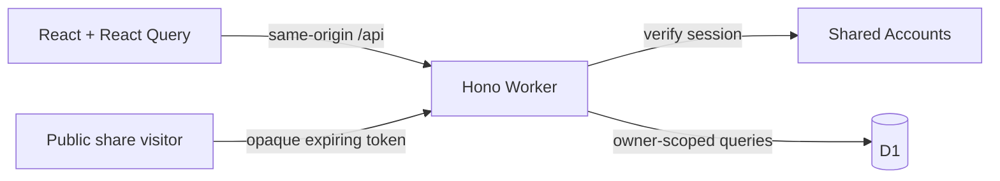

# Architecture

Worth is one same-origin React application and Cloudflare Worker. D1 holds private
records and bounded photo BLOBs. Shared Accounts owns authentication.

## Ownership

| Location               | Responsibility                                                                          |
| ---------------------- | --------------------------------------------------------------------------------------- |
| `src/App.tsx`          | Public/private routing, session recovery, lazy screens and top-level error boundary     |
| `src/pages/`           | Page orchestration and query state                                                      |
| `src/components/`      | Cabinet UI, collection index, editors, list settings, workouts and dialogs              |
| `src/api.ts`           | Same-origin transport, bounded requests, cancellation and readable failures             |
| `src/shared/`          | Shared types/validation and pure ranking, capture, exercise and portability rules       |
| `src/hooks/`           | Account-scoped device drafts, photo drafts, connectivity and tab preferences            |
| `worker/index.ts`      | Public/private middleware, auth, write limits, route registration and errors            |
| `worker/routes/`       | Lists, items, logs, overview/patterns, search, shares, photos, portability and workouts |
| `worker/data.ts`       | Owner-scoped record lookup and database-to-API mapping                                  |
| `worker/http.ts`       | Request limits, validation, origin enforcement and response security headers            |
| `worker/operations.ts` | Retry identities, payload fingerprints and prior-operation lookup                       |
| `migrations/`          | Ordered additive D1 schema history                                                      |
| `tests/`, `e2e/`       | Pure/component/API regressions and production-build browser journeys                    |

Keep orchestration in the page/view, persistence in the API/Worker, and independent
editors in their own components. Do not introduce a repository layer that simply
forwards every query. Parameterized SQL and owner checks belong together. The
activity editor remains cohesive because its measurements, draft, photos and workout
selection form one save operation; split further when a section gains independent behavior.

## Data invariants

- A collection contains items and dated revisits. An activity contains dated logs,
  optional exercise sets, workout visits and reusable routines.
- Calls are `favorite`, `meh`, `would_not_again` or `null`. Rank and revisit queue are
  separate, as is Want to try; sorting a screen never changes saved rank. Conflicting rank revisions
  return 409 and require refreshed data rather than silently overwriting another edit.
- Drafts expire after seven days and use the account and record/list identity. Collection browsing
  context stays in tab memory; global Search uses `q` and `scope` URL parameters. Blocked device
  storage must not stop browsing. Draft persistence is best effort, not a backup.
- Capture and restore retries preserve operation identities. Payload fingerprints keep
  a changed batch/import from being replayed under an old key. UI timeouts do not prove
  that a server mutation failed; verify saved state before retrying an ambiguous operation.
- Every private lookup/mutation verifies the owner. IDs alone do not grant access.
  Cross-origin writes are rejected. The browser never receives Accounts credentials
  beyond the existing shared session cookie.

## Sharing, files and caching

Public tokens are hashed in storage and expire after seven days. Snapshots contain
only ranked titles/types and a collection name; subsequent private edits do not update
an existing snapshot. Revocation removes access to the link. Images handed to a share
sheet or downloaded cannot be revoked. Keep preview options fixed during link creation.

Photos/covers are owner-checked, no-store and limited to 900 KB after client compression.
Records-only export excludes them; photo-inclusive backup includes them. Restore validates
and atomically creates fresh private records, preserves relationships and never restores
public shares. See [release/recovery](../RELEASE.md) for import limits and deletion scope.

The service worker handles the app shell/static assets; it must not cache private API
responses or invent offline write success. Private and shared routes have no-index headers.
Fonts are bundled locally. Static CSP/security headers live in `public/_headers`; API
headers are applied by the Worker. No mock archive is bundled into production.

## Build and release

Vite emits `dist/client` and `dist/worth`, including a generated Wrangler configuration.
CI builds once, uploads that complete output, then browser-tests and deploys the same
artifact. Deployment runs only for `main`, after core and browser checks, and applies
migrations before deploying with the generated config. PRs have no deployment step.
The deploy job is serialized and ends with the read-only live smoke check.

Unit/component tests use Vitest. API tests run against a temporary real D1 runtime;
auth is mocked at the Accounts-client boundary. Browser tests use Chromium with
synthetic intercepted API responses and test both 1440×900 and 390×780. These tests
cover UI contracts, not the production Accounts service or a real phone's native share sheet.

## Recoverable archive operations

Migration 0011 adds `trashed_at`, `want_to_try`, `merged_into_id` and active read views.
Ordinary reads use `active_lists`, `active_items` and `active_logs`; `record_items`
also includes preserved merged originals for history, photos and export. Writes
still target the original tables. Lookups cannot access records underneath a trashed
parent. New queries must preserve these boundaries.

Bulk operations use one guarded D1 transaction and an owner-bound, fingerprinted
retry receipt. JSON selections bound query/parameter counts even for 100-item Undo.
Rank removal edits the current database order and increments its revision. Moving a
main item carries its merged originals and all attached logs, including trashed logs.
Merges preserve original rows and photo/log ownership; separating changes membership,
without overwriting either record. Export/import preserves the merge relationship.

See [archive tools](ARCHIVE-TOOLS.md) for retention, privacy and UI contracts.

## Collection workbench

`CollectionWorkbench` owns a local ranking sandbox, binary-insertion head-to-head
comparisons, a private comparison table and filtered shuffled draws. Pure ordering
rules live in `src/shared/workbench.ts`. Drafts use the existing account/list-scoped
seven-day draft storage; comparisons are intentionally in memory. Applying an order
uses the existing rank revision boundary and an explicit old/new confirmation.

Migration 0012 adds `lists.workspace_json` and an independent workspace revision.
`worker/routes/workspace.ts` validates and persists bounded named views and context
rankings. A single conditional update checks the owner, active parent, revision and
all selected active item relationships. Requests are limited to 512 KiB, with at most
20 rankings of 500 unique items and 30 filter views. Other JSON routes keep 16 KiB.
Concurrent tabs receive 409 instead of overwriting newer tools. These changes do
not touch the main ranking, calls or list recency.

Reads omit absent/trashed/merged/moved items from context orders. Export includes
workspace state only for active lists and remaps context item IDs on restore; old
backups default to empty tools. Deleting all data cascades through the containing
lists. Public snapshots retain their fixed title/type-only payload. See the
[expansion tracker](CABINET-EXPANSION.md) for the larger unfinished scope.

## Private item context

Migration 0013 adds `items.context_json` and `context_revision`. Shared validation
and calendar serialization live in `src/shared/item-context.ts`; the editor and
read-only presentation are separate components. Context is optional and does not
change calls, rankings, revisit status or the name-only capture path.

Item create/patch requests allow 32 KiB; context arrays/text have explicit bounds.
An actual context change requires its expected revision, checked in the same SQL
update as the record fields. Identical retries preserve the revision. Patches that
do not change context leave its JSON untouched. The editor persists the expected
revision with its draft; newer server context cannot silently replace local edits.
Reloading context requires confirmation and preserves unrelated form edits.

Exports/imports include context and older files default to empty context. Merge,
move and Trash retain the original item row. Read-only context remains accessible
on merged originals and the comparison table. Collection search includes context;
global search matches meaningful JSON scalar values rather than field names or
default state markers. Saved filter views include optional label/stamp filters.

Calendar reminders are local `.ics` downloads with an explicit title/date preview,
an all-day event and a one-day-before display alarm. Serialization escapes text
and folds by UTF-8 octets. Person/private-note fields are not put in these files.
Worth does not request notification permission, schedule a server job or send a
message. Importing the file into a calendar is a separate user action.

## Booklets and recommendation cards

`CollectionPublishing` is a fourth workbench tool. It explicitly projects selected
records into bounded export models in `src/shared/booklet.ts`; context, history,
source links, internal IDs and account details are excluded. Booklets include up
to 12 names/types, a cover title, dedication and captions. Ranks, calls, private
notes and photos require opt-in. Cards include one name/type and a user-written
message/recipient; collection name and photo are optional. Existing public snapshot
payloads are unchanged.

`booklet-export.ts` embeds local WOFF2 fonts and selected owner-checked raster
photos into self-contained HTML, or renders a 1080-pixel-wide PNG. Asset failures
stop preparation and retain settings for retry. Unmount aborts preparation.
HTML escapes all text, validates data URLs and contains a restrictive CSP with no
scripts or network access. It opens offline and prints on A5 pages. In-app print
uses a portal with only the selected prepared data; print CSS hides the rest of
the app. Its page rule exists only while that prepared booklet is mounted.

The current projection fingerprints the prepared file; edits disable download,
print and sharing until a new file is prepared. Card previews show the actual PNG
and provide its full text to assistive technology. Native sharing is offered only
when the browser supports that file; cancelling never initiates a download.
Export settings use account/list-scoped seven-day device drafts, not server
persistence. No API writes or third-party processing occur during preparation.
Downloaded/shared files cannot be revoked.
